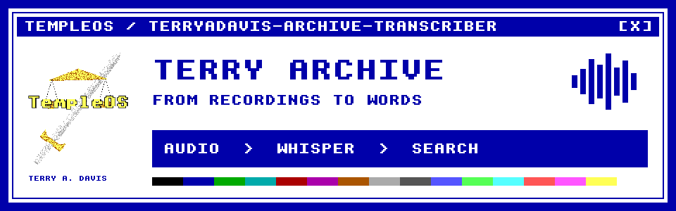

<p align="center">
  
</p>

# Terry A. Davis archive transcriber

**Searchable transcripts of the Terry A. Davis video archive.** A resumable Whisper pipeline that feeds TempleOS-Web's Terry Search.

**[Browse the original archive →](https://archive.org/details/TerryADavis_TempleOS_Archive)**

---

<details>
<summary><b>Run</b></summary>

<br>

Install Python 3 and **ffmpeg** (available on `PATH`), then run from this checkout:

```sh
python3 -m venv .venv
. .venv/bin/activate
pip install -r requirements.txt
python main.py --model large-v3-turbo
```

This processes the archive, downloads model weights as needed and writes under `output/`. Run the same command again to resume. It is a long-running archive job, not a single-video command.

The default installed backend is faster-whisper, using NVIDIA CUDA when available and CPU otherwise. Optional MLX Whisper support serves Apple Silicon. See [requirements.txt](requirements.txt) for backend and recovery dependencies.

</details>

---

<details>
<summary><b>Output and recovery</b></summary>

<br>

| Path | Contents |
|---|---|
| `output/transcripts/` | Plain text and JSON transcripts with metadata |
| `output/logs/progress.json` | Resume state |
| `output/logs/errors.log` | Errors |
| `output/logs/unrecoverable.csv` | Sources needing manual investigation |

The pipeline prefers archive audio derivatives, then extracts audio with ffmpeg. Temporary WAVs are removed after transcription. Recovery can temporarily download full videos, try `untrunc`, or retrieve a YouTube original when its ID is known.

Recovered or partial results are marked in their metadata. Machine transcripts can mishear names, code and speech; check the recording before quoting them.

</details>

---

<details>
<summary><b>Options and integration</b></summary>

<br>

```sh
python main.py --help
python main.py --workers 2 --batch-size 1
python main.py --verify-hashes
python main.py --retry-corrupt
```

`--no-recovery` disables corrupt-source recovery; `--recovery-max-mb` bounds each recovery download. `--beam-size` and `--model` adjust transcription.

[main.py](main.py) documents the pipeline and defaults. TempleOS-Web's [transcript builder](https://github.com/ParkerrDev/TempleOS-Web/blob/master/Apps/Search/TranscriptsMk.mjs) prepares these outputs for search.

</details>

---

<details>
<summary><b>Credits</b></summary>

<br>

TempleOS, HolyC, the sword-and-scales artwork and the 8×8 system font were created by **Terry A. Davis**. TempleOS is public domain. The banner uses its font and artwork.

Recordings come from the Internet Archive's [Terry A. Davis / TempleOS collection](https://archive.org/details/TerryADavis_TempleOS_Archive). Transcription uses Whisper through the installed backend; transcripts are generated text, not Terry's source code.

</details>
